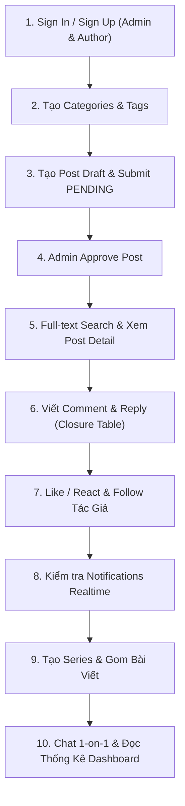

# Hướng Dẫn Sử Dụng Postman Collection – NestJS Blog Technical Platform

Tài liệu này hướng dẫn cách import và thực hiện test toàn bộ các chức năng (Phase 1 đến Phase 4) của hệ thống **NestJS Blog Technical Platform** bằng Postman.

---

## 1. Hướng Dẫn Import Vào Postman

Trong thư mục gốc của project đã có sẵn 2 file:
1. **`postman_blog_technical_collection.json`**: Chứa toàn bộ các request APIs kèm request body mẫu, headers và test script tự động bắt token/ID.
2. **`postman_blog_technical_environment.json`**: Chứa các biến môi trường cấu hình sẵn (`baseUrl`, `accessToken`, `adminToken`, v.v.).

### Các bước thực hiện:
1. Mở ứng dụng **Postman**.
2. Nhấn nút **Import** ở góc trên bên trái.
3. Kéo thả hoặc chọn 2 file:
   - `postman_blog_technical_collection.json`
   - `postman_blog_technical_environment.json`
4. Ở góc trên bên phải của Postman, chọn Environment là: **`NestJS Blog Technical - Local`**.
5. Đảm bảo biến `baseUrl` trỏ tới `http://localhost:3000` (hoặc cổng mà backend đang chạy).

> [!TIP]
> **Cơ Chế Auto Token & Variable Capture**: 
> Khi bạn chạy request **"Sign In (Admin)"** hoặc **"Sign In (Author)"**, Postman Test Scripts sẽ **tự động lưu `adminToken` và `accessToken` vào Environment**. 
> Tương tự, khi tạo Category, Tag, Post, Comment, Conversation, các ID sinh ra (`createdPostId`, `createdCategoryId`...) sẽ tự động gán vào biến môi trường cho các request tiếp theo dùng lại.

---

## 2. Chuẩn Bị Dữ Liệu: Khởi Tạo Database & Tài Khoản Admin Trước Khi Test

> [!IMPORTANT]
> **Bước Tiên Quyết - Chạy Migration**:
> Nếu vừa mới dựng DB mới hoặc chạy Docker lần đầu, bạn cần chạy Migration để tạo đủ 13 bảng trước khi có thể Sign-In hay Sign-Up:
> - **Nếu dùng Docker**:
>   ```powershell
>   docker compose --env-file ./.env.dev -f docker-compose.dev.yml exec api npm run migration:run
>   ```
> - **Nếu chạy trên máy host**:
>   ```powershell
>   npm run migration:run
>   ```

Để có tài khoản **Admin** đăng nhập cho request `Sign In (Admin)`, bạn có thể chọn **1 trong 4 cách** dưới đây:

### 🔹 Cách 1: Sử dụng Script Bootstrap trên Docker (Khuyến nghị khi dùng Docker)
Dự án có sẵn script bootstrap tự động hash mật khẩu, kích hoạt email và gán quyền `Admin`:
```powershell
docker compose --env-file ./.env.dev -f docker-compose.dev.yml exec -e BOOTSTRAP_ADMIN_EMAIL="admin@example.com" -e BOOTSTRAP_ADMIN_PASSWORD="ExamplePass123!" -e BOOTSTRAP_ADMIN_FIRST_NAME="System" -e BOOTSTRAP_ADMIN_LAST_NAME="Admin" api npm run bootstrap:admin:dev
```

### 🔹 Cách 2: Sử dụng Script Bootstrap trên máy Local (Host)
Nếu bạn chạy backend trực tiếp bằng `npm run start:dev` trên máy tính:
```powershell
$env:BOOTSTRAP_ADMIN_EMAIL="admin@example.com"
$env:BOOTSTRAP_ADMIN_PASSWORD="ExamplePass123!"
$env:BOOTSTRAP_ADMIN_FIRST_NAME="System"
$env:BOOTSTRAP_ADMIN_LAST_NAME="Admin"
npm run bootstrap:admin:dev
```

### 🔹 Cách 3: Đăng ký Sign-Up qua Postman rồi gán quyền Admin qua SQL
1. Chạy request **`POST /auth/sign-up`** trên Postman với thông tin tài khoản bạn muốn làm Admin:
   ```json
   {
     "first_name": "System",
     "last_name": "Admin",
     "email": "admin@example.com",
     "password": "ExamplePass123!"
   }
   ```
2. Mở PostgreSQL (Terminal, DBeaver hoặc pgAdmin) và chạy lệnh SQL thăng hạng tài khoản thành `Admin`:
   ```sql
   UPDATE users 
   SET role_id = (SELECT id FROM user_roles WHERE name = 'Admin'),
       "isActive" = true,
       "isEmailVerified" = true
   WHERE email = 'admin@example.com';
   ```

### 🔹 Cách 4: Thêm trực tiếp bằng câu lệnh SQL vào Database (DBeaver / pgAdmin / psql)
Chạy trực tiếp đoạn script SQL sau vào database để tạo ngay tài khoản `admin@example.com` với mật khẩu đã mã hóa sẵn là `ExamplePass123!`:
```sql
-- 1. Đảm bảo role Admin đã tồn tại trong bảng user_roles
INSERT INTO user_roles (id, name, _description)
VALUES (gen_random_uuid(), 'Admin', 'System Administrator')
ON CONFLICT (name) DO NOTHING;

-- 2. Thêm hoặc cập nhật tài khoản Admin (Password đã hash bcrypt là ExamplePass123!)
INSERT INTO users (
    id, 
    first_name, 
    last_name, 
    email, 
    username, 
    password, 
    "isEmailVerified", 
    "isActive", 
    role_id
)
VALUES (
    gen_random_uuid(),
    'System',
    'Admin',
    'admin@example.com',
    'admin_root',
    '$2a$12$aSUo6j1u8M7qCKa/uLxBTOLklcFFQArsqZzPiFrkOB/y1sftaEQni',
    true,
    true,
    (SELECT id FROM user_roles WHERE name = 'Admin')
)
ON CONFLICT (email) DO UPDATE SET 
    role_id = EXCLUDED.role_id,
    "isActive" = true,
    "isEmailVerified" = true;
```

---

## 3. Thứ Tự Test Khuyến Nghị (Step-by-Step Flow)



---

## 4. Danh Sách Chi Tiết Toàn Bộ API, Request Data & Sample Response

### 📁 1. Authentication (`/auth`)

#### `POST /auth/sign-in` (Đăng nhập Author hoặc Admin)
- **Auth**: Public
- **Request Body**:
```json
{
  "email": "author_test@example.com",
  "password": "Password123!"
}
```
- **Response (200 OK)**:
```json
{
  "data": {
    "access_token": "eyJhbGciOiJIUzI1NiIsInR5cCI6IkpXVCJ9...",
    "refresh_token": "eyJhbGciOiJIUzI1NiIsInR5cCI6IkpXVCJ9...",
    "user": {
      "id": "a1b2c3d4-e5f6-7890-abcd-ef1234567890",
      "email": "author_test@example.com",
      "username": "author_test",
      "role": { "name": "Author" }
    }
  },
  "message": "Login successful",
  "timestamp": "2026-11-14T13:30:00.000Z"
}
```

---

### 📁 2. Quản Trị Users (`/users`)

#### `GET /users` (Admin - Danh sách Users kèm lọc)
- **Auth**: Bearer `adminToken`
- **Query Params**:
  - `role`: `User` | `Author` | `Admin`
  - `isActive`: `true` | `false`
  - `page`: `1`
  - `limit`: `10`
- **Response (200 OK)**:
```json
{
  "data": {
    "items": [
      {
        "id": "a1b2c3d4-e5f6-7890-abcd-ef1234567890",
        "email": "author_test@example.com",
        "username": "author_test",
        "isActive": true,
        "role": { "name": "Author" }
      }
    ],
    "total": 1
  }
}
```

#### `PATCH /users/:id/role` (Admin - Thay đổi vai trò người dùng)
- **Auth**: Bearer `adminToken`
- **Request Body**:
```json
{
  "role": "Author"
}
```
- **Response (200 OK)**: User entity với `role.name` mới.

#### `PATCH /users/:id/status` (Admin - Khóa / Mở khóa tài khoản)
- **Auth**: Bearer `adminToken`
- **Request Body**:
```json
{
  "isActive": false
}
```
- **Response (200 OK)**: User entity với `isActive: false` (người dùng bị khóa sẽ không thể đăng nhập hoặc kết nối socket).

---

### 📁 3. Categories (`/categories`)

#### `POST /categories` (Admin tạo chuyên mục)
- **Auth**: Bearer `adminToken`
- **Request Body**:
```json
{
  "name": "Backend Engineering",
  "description": "Architecture, microservices, databases and high performance systems.",
  "icon": "server",
  "order": 1
}
```
- **Response (201 Created)**:
```json
{
  "data": {
    "id": "c1d2e3f4-1234-5678-9abc-def012345678",
    "name": "Backend Engineering",
    "slug": "backend-engineering",
    "description": "Architecture, microservices, databases and high performance systems.",
    "postCount": 0
  }
}
```

#### `GET /categories` (Lấy danh sách chuyên mục)
- **Auth**: Public
- **Response (200 OK)**: Danh sách categories có cache Redis tự động.

---

### 📁 4. Tags (`/tags`)

#### `POST /tags` (Tạo thẻ tag mới)
- **Auth**: Bearer `accessToken`
- **Request Body**:
```json
{
  "name": "NestJS",
  "description": "A progressive Node.js framework for scalable server-side apps."
}
```
- **Response (201 Created)**: Tag entity với slug tự sinh `nestjs`.

#### `GET /tags/popular` (Lấy top tags thịnh hành)
- **Auth**: Public
- **Query Params**: `limit=10`

---

### 📁 5. Posts (`/posts`)

#### `POST /posts` (Tạo bài viết DRAFT)
- **Auth**: Bearer `accessToken` (Author/Admin)
- **Rate Limit**: Tối đa 5 requests / giờ
- **Request Body**:
```json
{
  "title": "Building Scalable Realtime APIs with NestJS and Redis",
  "excerpt": "A comprehensive technical guide to scaling WebSockets with Redis Adapter and BullMQ.",
  "content": "# Introduction\n\nIn this article, we explore horizontally scaling Socket.IO inside NestJS applications...",
  "level": "advanced",
  "categoryId": "{{createdCategoryId}}",
  "tagNames": ["NestJS", "Redis", "WebSockets"],
  "metaTitle": "Building Scalable Realtime APIs with NestJS",
  "metaDescription": "Learn how to scale NestJS WebSockets across multiple nodes with Redis."
}
```
- **Response (201 Created)**: Post entity với trạng thái `DRAFT`, tính toán `readingTime` tự động.

#### `POST /posts/:id/submit` (Author gửi bài chờ duyệt)
- **Auth**: Bearer `accessToken`
- **Response (200 OK)**: Post chuyển trạng thái từ `DRAFT` sang `PENDING`.

#### `POST /posts/:id/approve` (Admin duyệt bài viết)
- **Auth**: Bearer `adminToken`
- **Response (200 OK)**: Post chuyển sang `PUBLISHED`, gửi thông báo realtime + job email cho author và người theo dõi.

#### `POST /posts/:id/reject` (Admin từ chối bài viết)
- **Auth**: Bearer `adminToken`
- **Request Body**:
```json
{
  "reason": "Please format code snippets with syntax highlighting and elaborate on Redis cluster failover."
}
```
- **Response (200 OK)**: Post về `DRAFT` kèm `rejectReason`.

#### `GET /posts/search` (Tìm kiếm toàn văn Full-text Search)
- **Auth**: Public
- **Query Params**:
  - `q`: `NestJS Realtime`
  - `page`: `1`
  - `limit`: `10`
- **Response (200 OK)**:
```json
{
  "data": {
    "items": [
      {
        "id": "p1-uuid",
        "title": "Building Scalable Realtime APIs with NestJS and Redis",
        "slug": "building-scalable-realtime-apis-with-nestjs-and-redis",
        "readingTime": 3,
        "viewCount": 15,
        "reactionCount": 4
      }
    ],
    "count": 1
  }
}
```

#### `GET /posts/sitemap.xml` (SEO Sitemap)
- **Auth**: Public
- **Response (200 OK)**: XML sitemap hợp lệ theo chuẩn `sitemaps.org`.

---

### 📁 6. Comments (`/comments`)

#### `POST /comments/posts/:postId` (Bình luận gốc trên bài viết)
- **Auth**: Bearer `accessToken`
- **Rate Limit**: 10 requests / phút
- **Request Body**:
```json
{
  "content": "Excellent guide! Could you explain how to configure Redis TLS certificates?"
}
```
- **Response (201 Created)**: Comment cấp 0 (`depth: 0`).

#### `POST /comments/:commentId/replies` (Trả lời bình luận con)
- **Auth**: Bearer `accessToken`
- **Request Body**:
```json
{
  "postId": "{{createdPostId}}",
  "content": "For TLS, you can pass ca, cert, and key buffers in the redis createClient options!"
}
```
- **Response (201 Created)**: Comment cấp 1 (`depth: 1`), liên kết quan hệ trong bảng `comment_closures`.

#### `GET /comments/posts/:postId/tree` (Lấy cây bình luận phân cấp)
- **Auth**: Bearer `accessToken`
- **Response (200 OK)**: Danh sách comment cha kèm mảng `replies` đệ quy.

---

### 📁 7. Reactions & Follows

#### `POST /posts/:id/reactions` (Thả Like / Reaction)
- **Auth**: Bearer `accessToken`
- **Request Body**:
```json
{
  "type": "like"
}
```
- **Response (200 OK)**: Tự động cộng/trừ số lượng `reactionCount` của bài viết theo cơ chế toggle.

#### `POST /users/:id/follow` (Theo dõi tác giả)
- **Auth**: Bearer `accessToken`
- **Response (200 OK)**: `{ "success": true, "message": "Followed author successfully" }`

#### `POST /categories/:id/subscribe` (Đăng ký theo dõi chuyên mục)
- **Auth**: Bearer `accessToken`
- **Response (200 OK)**: `{ "success": true, "message": "Subscribed to category successfully" }`

---

### 📁 8. Chat Realtime (`/chat`)

#### `POST /chat/conversations` (Bắt đầu cuộc trò chuyện 1-on-1)
- **Auth**: Bearer `accessToken`
- **Request Body**:
```json
{
  "participantId": "{{targetUserId}}"
}
```
- **Response (200 OK)**: Conversation entity (nếu đã tồn tại cuộc trò chuyện giữa 2 người thì trả về conversation cũ, nếu chưa thì tạo mới).

#### `POST /chat/conversations/:id/messages` (Gửi tin nhắn)
- **Auth**: Bearer `accessToken`
- **Rate Limit**: 30 requests / phút
- **Request Body**:
```json
{
  "content": "Hello! I read your post about NestJS scaling and had a question."
}
```
- **Response (201 Created)**: Tin nhắn mới được lưu và đồng thời broadcast qua WebSocket room `conversation:<id>`.

---

### 📁 9. Settings (`/settings`)

#### `PUT /settings/:key` (Admin cấu hình hệ thống)
- **Auth**: Bearer `adminToken`
- **Request Body**:
```json
{
  "value": "true",
  "description": "Require administrator approval before posts become public"
}
```

---

## 4. Hướng Dẫn Test WebSocket Realtime (Socket.IO)

Trong Postman, bạn có thể tạo một tab **Socket.IO** request để kiểm tra realtime:

1. **URL**: `ws://localhost:3000`
2. **Auth Header / Handshake Auth**:
   - `auth: { "token": "<your_jwt_access_token>" }`
3. **Events để Listen**:
   - `connected`: Nhận thông báo kết nối thành công.
   - `new_notification`: Nhận thông báo khi có bài viết được duyệt hoặc có bình luận mới.
   - `new_message`: Nhận tin nhắn chat realtime.
   - `user_typing`: Trạng thái đang gõ phím.
4. **Events để Emit**:
   - `join_post_room`: `{ "postId": "uuid" }`
   - `join_conversation`: `{ "conversationId": "uuid" }`
   - `typing`: `{ "conversationId": "uuid", "isTyping": true }`

