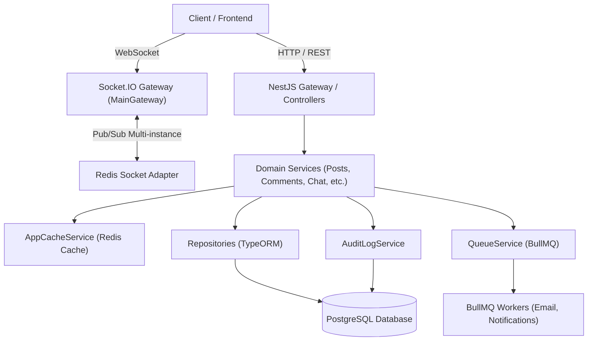

# NestJS Technical Blog Platform – Production Implementation & Deployment Guide

## 1. Project Overview & Architecture

Hệ thống **NestJS Blog Technical** được phát triển theo tiêu chuẩn production-grade, tuân thủ Clean Architecture, Repository Pattern, Caching (Redis), Realtime WebSockets, Asynchronous Queue (BullMQ), và Auditing.



---

## 2. Các Phase Đã Hoàn Thành (100%)

### Phase 1: Foundation – Posts, Categories & Tags
- **Categories & Tags**: CRUD hoàn chỉnh, hỗ trợ auto-generate slug, count bài viết, cache tự động invalidate.
- **Posts Lifecycle**:
  - Trạng thái bài viết: `DRAFT` ➔ `PENDING` ➔ `PUBLISHED` / `ARCHIVED`.
  - Tự động tính `readingTime` (words / 200).
  - Slug generation đảm bảo unique chống trùng lặp.
  - Multi-tag & Category relations với transaction rollback an toàn.
  - Increment view count không block request.

### Phase 2: Social & Interactions
- **Nested Comments (Tree Closure Table)**:
  - Hỗ trợ comment phân cấp vô hạn không bị N+1 query.
  - Lấy comment tree phân trang, soft-delete comment kèm con cháu.
  - Ẩn/Hiện comment phục vụ kiểm duyệt (Moderation).
- **Socket & Realtime**:
  - `MainGateway` với JWT authentication cho socket connections.
  - Private rooms cho user (`user:<userId>`), room bài viết (`post:<postId>`), và room chat (`conversation:<id>`).
  - Online/offline tracking, typing indicator realtime.
- **Notifications**: In-app notifications realtime với cache unread count.
- **Reactions & Follows**:
  - Like / Upvote / Downvote toggle linh hoạt.
  - Follow tác giả & Subscribe danh mục; tự động push notification khi có bài viết mới.
- **Series & Dashboard**:
  - Gom bài viết theo chuyên đề, ordering theo thứ tự `orderIndex`.
  - Dashboard thống kê chuyên sâu: Total posts, views, reactions, comments, top bài viết theo view.

### Phase 3: Admin & Advanced Features
- **Quản trị người dùng & RBAC**:
  - Filter user theo role, active status, search email / fullName.
  - Đổi quyền user (`PATCH /users/:id/role`) kèm ràng buộc chống tự hạ quyền chính mình.
  - Khóa/Mở khóa tài khoản (`PATCH /users/:id/status`) kèm ràng buộc an toàn.
- **Admin Review Posts**:
  - Duyệt bài (`POST /posts/:id/approve`): Chuyển trạng thái `PUBLISHED`, gửi notification & email cho author, thông báo follower.
  - Từ chối bài (`POST /posts/:id/reject`): Lưu lý do từ chối, gửi notification realtime.
  - Khôi phục bài xóa mềm (`POST /posts/:id/restore`).
- **Chat 1-on-1**:
  - `findOrCreateConversation`, gửi tin nhắn realtime và qua HTTP fallback.
  - Phân trang tin nhắn và đánh dấu đã đọc (`PATCH /chat/conversations/:id/read`).
- **Settings Module**: Quản trị cấu hình runtime động (`GET`, `PUT /settings/:key`).

### Phase 4: Polish & Production Ready
- **P4-01 Full-text Search**:
  - Endpoint `GET /posts/search?q=keyword&page=1&limit=10`.
  - Tìm kiếm toàn văn trên cả `title`, `excerpt` và `content`, phân trang và chỉ trả về bài `PUBLISHED`.
- **P4-02 Rate Limiting**:
  - Chống spam với `@Throttle`:
    - Comment: tối đa 10 requests / phút.
    - Tạo bài viết: tối đa 5 requests / giờ.
    - Chat message: tối đa 30 requests / phút.
- **P4-03 Redis Adapter cho Socket.IO**:
  - `RedisIoAdapter` sử dụng `@socket.io/redis-adapter` và `redis`.
  - Cho phép scale ngang (horizontal clustering) nhiều instance server mà client vẫn nhận event realtime chéo node.
  - Cơ chế tự phục hồi: nếu Redis chưa sẵn sàng, adapter tự fallback về in-memory mode để dev/test không bị crash.
- **P4-04 Email Notification qua BullMQ**:
  - Tích hợp `QueueService` vào `NotificationsService` qua interface độc lập không phụ thuộc ESM.
  - Tự động enqueue email job khi bài viết được duyệt (`POST_APPROVED`), từ chối (`POST_REJECTED`), hoặc khi có bài mới từ tác giả đang theo dõi.
- **P4-05 SEO Meta & Sitemap**:
  - Trường SEO `metaTitle`, `metaDescription`, `canonicalUrl` sẵn sàng trên Post entity.
  - Endpoint `GET /posts/sitemap.xml` sinh sitemap XML chuẩn Google cho tất cả bài viết published.
- **P4-08 Clean code & Database Migrations**:
  - Dọn dẹp các module mẫu cũ (`checkin`, `flash-cards`, `topics`, `collections`).
  - Migration `1793300000000-BlogPhase4Cleanup.ts` drop các bảng thừa an toàn.

---

## 3. Database Migrations List

Các file migration đã sẵn sàng trong `src/database/migrations/`:
1. `1793000000000-BlogPhase1Entities.ts` (Categories, Tags, Posts, Post_Tags)
2. `1793100000000-BlogPhase2Entities.ts` (Comments, Comment_Closures, Notifications, Follows, Category_Subscriptions, Reactions, Series, Series_Posts)
3. `1793200000000-BlogPhase3Entities.ts` (Chat_Conversations, Conversation_Participants, Chat_Messages, Settings, User isActive column)
4. `1793300000000-BlogPhase4Cleanup.ts` (Drop legacy tables: checkins, flash_cards...)

---

## 4. Kiểm Thử & Verify Build

- **Unit Test Suites**: **16 / 16 PASSED** (68 / 68 unit tests passed).
- **TypeScript Build**: `npm run build` ➔ **PASSED** (exit code 0).
- **Git status**: Thư mục `.git` cũ đã được dọn sạch, sẵn sàng khởi tạo repo mới (`git init`).

---

## 5. Hướng Dẫn Deploy & Chạy Dự Án

### Bước 1: Chuẩn bị biến môi trường
Tạo file `.env` từ `.env.example`:
```env
PORT=3000
NODE_ENV=production

# Database Postgres
DB_HOST=localhost
DB_PORT=5432
DB_USERNAME=postgres
DB_PASSWORD=your_secure_password
DB_DATABASE=nestjs_blog_db

# Redis (Cache, BullMQ, Socket Adapter)
REDIS_HOST=localhost
REDIS_PORT=6379
REDIS_PASSWORD=

# JWT Secrets
JWT_ACCESS_TOKEN_SECRET=your_access_token_secret
JWT_ACCESS_TOKEN_EXPIRATION_TIME=1h
JWT_REFRESH_TOKEN_SECRET=your_refresh_token_secret
JWT_REFRESH_TOKEN_EXPIRATION_TIME=7d

# Swagger Docs
SWAGGER_ENABLED=true
SWAGGER_USERNAME=admin
SWAGGER_PASSWORD=admin
```

### Bước 2: Khởi động Infrastructure qua Docker (Postgres + Redis)
```bash
docker compose --env-file ./.env.dev -f docker-compose-infrastructure.yml up -d
```

### Bước 3: Chạy Database Migrations
```bash
npm run migration:run
```

### Bước 4: Khởi tạo tài khoản Admin mặc định
```bash
npm run bootstrap:admin
```

### Bước 5: Build & Run Production Server
```bash
npm run build
npm run start:prod
```

### Bước 6: Truy cập API Documentation
Mở trình duyệt truy cập:
- `http://localhost:3000/api` hoặc `http://localhost:3000/api-docs`
- Đăng nhập Basic Auth bằng tài khoản cấu hình trong `SWAGGER_USERNAME` / `SWAGGER_PASSWORD`.

